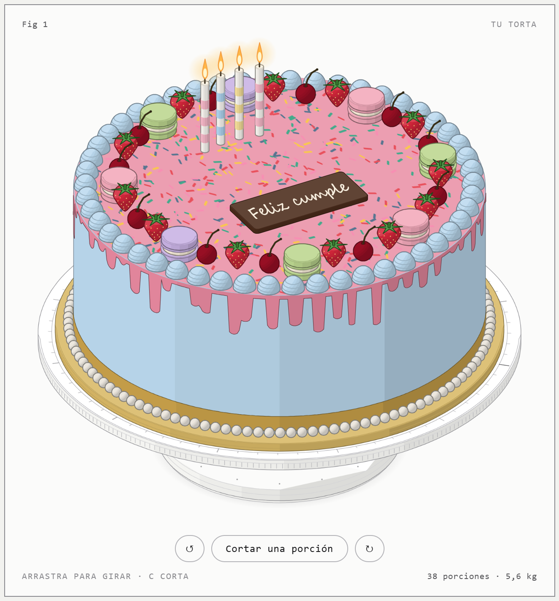

# LemonSuly · Pastelería artesanal

La página de la marca, con un playground para armar un lemon pie: tamaño (de individuales de 8 cm, de 1 a 6, hasta 26 cm), masa, relleno, acidez, merengue (con su tostado), toppings y un banderín con mensaje. El pie se dibuja en SVG con el estilo del logo y el diseño queda guardado en el enlace (`#pie?…`).

En el teléfono la acción principal queda abajo, al alcance del pulgar; el menú y el pedido se abren como hojas que suben desde abajo, y el pedido se puede enviar con el menú compartir del teléfono.

## Uso

```bash
node serve.mjs 5180   # luego abrir http://127.0.0.1:5180/
```

| Archivo | Qué hace |
|---|---|
| `index.html` | La página: portada, la carta, el playground, Suly y cómo pedir. |
| `pie.js` | Catálogo, precios de ejemplo y el dibujo del pie, del corte de una porción y de los íconos. |
| `app.js` | La carta, el playground, el pedido, la barra inferior, las hojas y las microinteracciones. En `CONTACT` se carga el WhatsApp para enviar el pedido directo. |
| `styles.css` | Paleta y tipografía de la marca (Montserrat, Nunito y Caveat). |
| `assets/` | Logos recortados del manual de marca. |
| `serve.mjs` | Servidor estático mínimo para probar la página en local. |
| `taller/` | El configurador de tortas anterior (ver abajo). No se publica. |

Los precios son valores de ejemplo.

## Publicación en GitHub Pages

GitHub Pages publica la rama `main` tal cual («Deploy from a branch», carpeta raíz): cada push a `main` actualiza el sitio. El archivo `.nojekyll` evita que GitHub procese la página con Jekyll.

Todo lo que está en el repositorio queda accesible en el sitio. Por eso la página del taller de tortas (`taller/index.html`) se genera en local y está en `.gitignore`.

## Taller de tortas

Configurador de tortas anterior, hecho con la skill [Anatomy](https://github.com/wheresryan22/anatomy): la torta se dibuja como un objeto isométrico sobre un giratorio de repostería, y cambia con cada opción.

<p align="center"> </p>

- **Tamaño**: diámetro (16–28 cm) y 2 o 3 capas de bizcocho.
- **Bizcocho, relleno y cobertura**: cobertura de buttercream o fondant en 6 colores, ganache o naked.
- **Toppings**: frutillas, arándanos, cerezas, macarons, chispas y virutas.
- **Decoración**: velas, placa con mensaje, borde de perlas, rosetas, chorreado y cinta.
- **Interacción**: arrastra para girar el plato; con «Cortar una porción» (o la tecla C) se saca una porción y se ven las capas por dentro.
- **Resumen**: porciones, peso y precio estimado, calculados con el mismo modelo que mueve el dibujo. El diseño queda guardado en el enlace (`#…`).

```bash
node taller/build.mjs   # genera taller/index.html desde taller/src/
node serve.mjs 5180     # luego abrir http://127.0.0.1:5180/taller/
```

| Archivo | Qué hace |
|---|---|
| `taller/src/model.mjs` | Catálogo (sabores, colores, densidades, precios de ejemplo), capas en mm, porciones, peso y precio. |
| `taller/src/figure.mjs` | El dibujo con el kit de Anatomy: giratorio, torta, corte, toppings y decoraciones. |
| `taller/src/app.js` | La página viva: formulario, giro con inercia, corte animado, cámara, URL, y el dibujo por capas (ver abajo). |
| `taller/build.mjs` | Junta el kit, el modelo, la figura y la página en `taller/index.html`. |
| `taller/vendor/anatomy/` | El kit de Anatomy (`iso-kit.mjs`, `lathe.mjs`), copiado sin cambios bajo licencia MIT. |

### Rendimiento

El dibujo se arma por capas en el orden del pintor (`F.LAYERS`). Para que el giro sea fluido:

- Las capas que no cambian al girar (giratorio, base, cuerpo de la torta) se arman una vez y, cuando quedan quietas, se reemplazan por una imagen de sí mismas a la escala actual.
- Las chispas y las marcas del plato están en un plano: giran con una sola transformación, sin redibujarse.
- Cada tipo de topping se rasteriza una vez en un atlas; al girar solo se mueven las imágenes.
- Las llamas de las velas parpadean en una capa aparte, así su animación no repinta la torta.

El botón «Pedir esta torta» solo muestra un resumen para copiar; no se envía nada.
