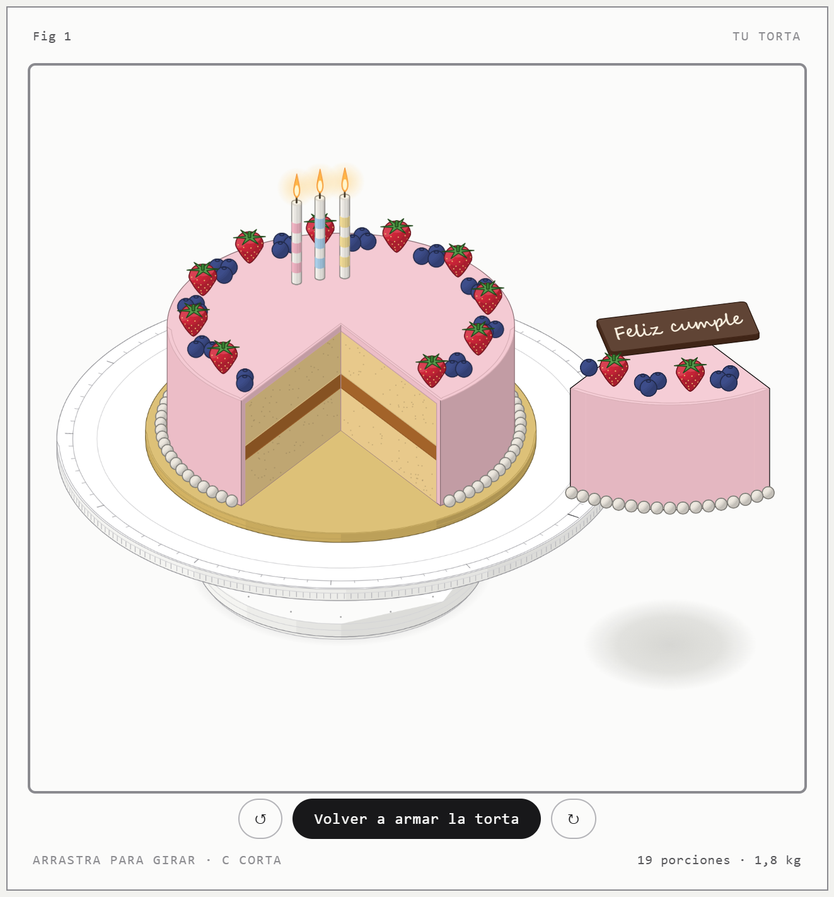

# Taller de tortas · prototipo

Configurador de tortas hecho con la skill [Anatomy](https://github.com/wheresryan22/anatomy): la torta se dibuja como un objeto isométrico sobre un giratorio de repostería, y cambia con cada opción.

<p align="center"> </p>

- **Tamaño**: diámetro (16–28 cm) y 2 o 3 capas de bizcocho.
- **Bizcocho, relleno y cobertura**: cobertura de buttercream o fondant en 6 colores, ganache o naked.
- **Toppings**: frutillas, arándanos, cerezas, macarons, chispas y virutas.
- **Decoración**: velas, placa con mensaje, borde de perlas, rosetas, chorreado y cinta.
- **Interacción**: arrastra para girar el plato; con «Cortar una porción» (o la tecla C) se saca una porción y se ven las capas por dentro.
- **Resumen**: porciones, peso y precio estimado, calculados con el mismo modelo que mueve el dibujo. El diseño queda guardado en el enlace (`#…`).

## Uso

`index.html` es una página autónoma: se puede abrir directamente en el navegador.

```bash
node build.mjs        # regenera index.html desde src/
node serve.mjs 5180   # opcional: servidor local en http://127.0.0.1:5180/
```

## Landing de LemonSuly

`landing/` es la página de la marca, con un playground para armar un lemon pie: tamaño, masa, relleno, acidez, merengue (con su tostado), toppings y un banderín con mensaje. El pie se dibuja en SVG con el estilo del logo y el diseño queda guardado en el enlace (`#pie?…`).

```bash
node serve.mjs 5180   # luego abrir http://127.0.0.1:5180/landing/
```

| Archivo | Qué hace |
|---|---|
| `landing/pie.js` | Catálogo, precios de ejemplo y el dibujo del pie, del corte de una porción y de los íconos. |
| `landing/app.js` | La carta, el playground, el pedido y las microinteracciones. En `CONTACT` se carga el WhatsApp para enviar el pedido directo. |
| `landing/styles.css` | Paleta y tipografía de la marca (Montserrat, Nunito y Caveat). |
| `landing/assets/` | Logos recortados del manual de marca. |

## Estructura

| Archivo | Qué hace |
|---|---|
| `src/model.mjs` | Catálogo (sabores, colores, densidades, precios de ejemplo), capas en mm, porciones, peso y precio. |
| `src/figure.mjs` | El dibujo con el kit de Anatomy: giratorio, torta, corte, toppings y decoraciones. |
| `src/app.js` | La página viva: formulario, giro con inercia, corte animado, cámara, URL, y el dibujo por capas (ver abajo). |
| `build.mjs` | Junta el kit, el modelo, la figura y la página en `index.html`. |
| `vendor/anatomy/` | El kit de Anatomy (`iso-kit.mjs`, `lathe.mjs`), copiado sin cambios bajo licencia MIT. |
| `serve.mjs` | Servidor estático mínimo para probar la página en local. |

## Rendimiento

El dibujo se arma por capas en el orden del pintor (`F.LAYERS`). Para que el giro sea fluido:

- Las capas que no cambian al girar (giratorio, base, cuerpo de la torta) se arman una vez y, cuando quedan quietas, se reemplazan por una imagen de sí mismas a la escala actual.
- Las chispas y las marcas del plato están en un plano: giran con una sola transformación, sin redibujarse.
- Cada tipo de topping se rasteriza una vez en un atlas; al girar solo se mueven las imágenes.
- Las llamas de las velas parpadean en una capa aparte, así su animación no repinta la torta.

Los precios son valores de ejemplo y el botón «Pedir esta torta» solo muestra un resumen para copiar; no se envía nada.
